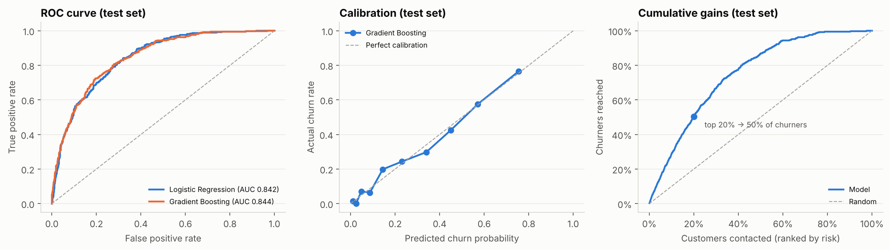
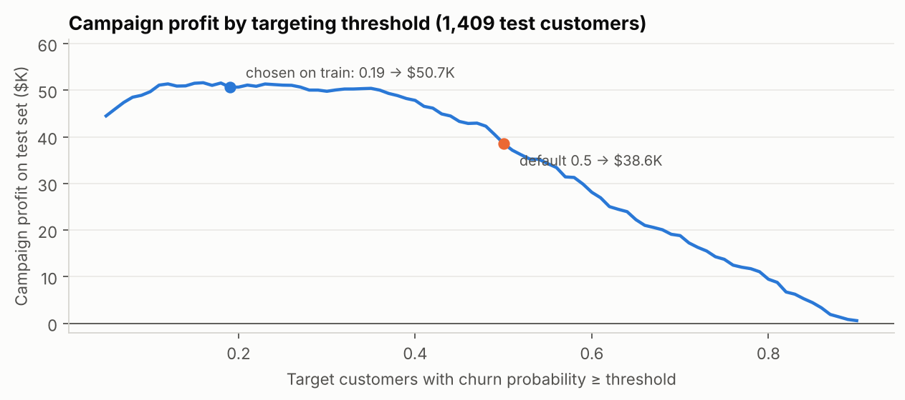

# Telecom Customer Churn: Prediction and Profit-Based Retention Targeting

**An end-to-end churn model for 7,043 telecom customers that turns predictions into a targeting decision: who should get a retention offer to maximise campaign profit.**

`Python` · `scikit-learn (Pipeline, ColumnTransformer, GridSearchCV)` · `Gradient boosting` · `Logistic regression` · `Model explainability` · `Cost-sensitive decision-making`

---

## Business problem

A telecom operator loses **26.5%** of its customers. The retention team can only afford offers for some of them. The question is not just "who will churn?" but **"who should we spend money on?"**

## Data

[IBM Telco Customer Churn](https://github.com/IBM/telco-customer-churn-on-icp4d): 7,043 customers, 19 features (demographics, services, contract, billing), churn label. The 11 blank `TotalCharges` values all belong to brand-new customers (tenure 0) and were set to 0.

## Approach

| Step | Details |
|---|---|
| EDA | Churn rate by contract, tenure, internet service and payment method |
| Leak-free pipeline | `ColumnTransformer` (scaling + one-hot encoding) inside a `Pipeline`, so preprocessing is fitted only on training folds |
| Validation | Stratified 80/20 split; **5-fold stratified CV** on the training set for model selection |
| Models | Logistic Regression, Random Forest, Gradient Boosting (HistGradientBoosting), then `GridSearchCV` on the best two |
| Evaluation | Test-set ROC-AUC, PR-AUC, Brier score, calibration curve, cumulative gains |
| Explainability | Logistic-regression odds ratios (interpretable companion model) and permutation importance |
| **Decision layer** | Targeting threshold chosen to **maximise expected campaign profit**, tuned on out-of-fold training predictions and *then* applied to the test set |

## Results

| Model | CV ROC-AUC | Test ROC-AUC | Test PR-AUC | Brier |
|---|---|---|---|---|
| **Gradient Boosting (selected by CV)** | **0.849** | **0.844** | **0.662** | **0.136** |
| Logistic Regression | 0.846 | 0.842 | 0.630 | 0.138 |



- **Lift:** contacting the riskiest 20% of customers reaches **50% of all churners (2.5× better than random)**.
- **Drivers:** month-to-month contracts, the first 6 months of tenure (53% churn), fibre-optic internet and electronic-cheque payment raise churn. Two-year contracts and long tenure lower it.

## From prediction to decision

Assumptions (all adjustable in the notebook): an offer costs **$50**, it saves **30%** of customers who would have churned, and a saved customer is worth **12 months of their monthly bill**.

| Strategy (1,409 test customers) | Customers targeted | Campaign profit |
|---|---|---|
| Target everyone | 1,409 | $27,524 |
| Default 0.5 threshold | 283 | $38,626 |
| **Profit-based threshold (0.19, chosen on training data)** | **688** | **$50,678 (+31% vs 0.5)** |



- The train-chosen threshold captures **98%** of the best profit achievable in hindsight on the test set.
- **Sensitivity:** across 9 scenarios (save rate 20–40%, offer cost $30–$80), the profit-based threshold beats the 0.5 default in **all 9**.
- Why 0.5 is wrong here: reaching a real churner is worth about **$268** on average (30% save rate × 12 months × $74 average bill), while an unnecessary offer costs only $50. It pays to flag customers even at moderate risk.

## Use the model

```bash
python src/predict.py data/raw/Telco-Customer-Churn.csv outputs/scored.csv
```

This loads `models/churn_model.joblib` (pipeline + chosen threshold) and writes a churn probability and a target / don't-target flag for each customer.

## Repository structure

```
├── data/download_data.py
├── notebooks/01_churn_model_and_targeting.ipynb
├── models/churn_model.joblib            # fitted pipeline + profit-based threshold
├── outputs/test_customers_scored.csv    # test-set scores, ranked
├── reports/figures/
└── src/
    ├── predict.py                       # score new customers
    └── style.py
```

## How to run

```bash
pip install -r requirements.txt
python data/download_data.py
jupyter notebook notebooks/01_churn_model_and_targeting.ipynb
```

## Limitations and next steps

- The 30% save rate and the 12-month value are assumptions. A randomised holdout in the first campaign would measure the real save rate, and an **uplift model** could then target customers the offer actually persuades, rather than those most likely to churn.
- The sample is a single snapshot, so retrain monthly and monitor drift in contract mix and pricing.
